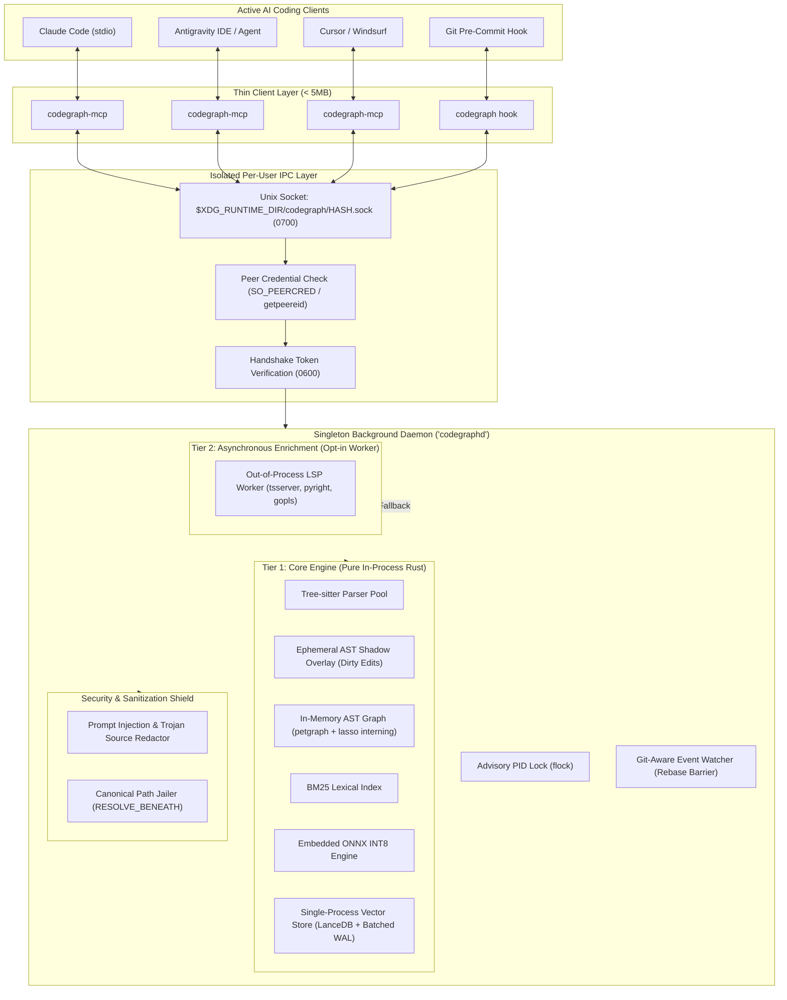

# Product Requirements Document (PRD)

## Project Name: `CodeGraph-MCP` (Codename: *Antidote*)
**Sub-title:** The Structural AST, Semantic Reuse, and Integrity Engine for AI Coding Agents  
**Target Clients:** Claude Code, Antigravity, Cursor, Windsurf, Aider (via Model Context Protocol - MCP)  
**Version:** 1.2 (Hardened Enterprise & Security Architecture)  
**License:** Apache 2.0 / MIT  
**Status:** Approved for Implementation  

---

## 1. Executive Summary

### 1.1 Problem Statement
The widespread adoption of autonomous AI coding assistants (Claude Code, Antigravity, Cursor) has created three critical enterprise bottlenecks:
1. **The Grep/Token-Burn Trap:** CLI and IDE agents explore codebases using rudimentary shell tools (`grep`, `find`, `cat`). This burns tens of thousands of tokens dumping raw source files into context, triggers premature context-window compaction, and causes severe reasoning degradation ("context amnesia").
2. **"Refactoring Oceans" & Semantic Duplication:** Industry data (GitClear, LeadDev) shows code duplication has surged by over 40% since the introduction of AI coding tools, while code reuse has plummeted. Lacking global structural awareness, agents persistently reinvent existing helper functions, schemas, and utility abstractions under variant names rather than reusing existing code.
3. **The Silent False-Positive & Blast-Radius Trap:** Agents frequently declare tasks complete with passing tests by either weakening assertions or failing to anticipate ripple-effect breakages across multi-package monorepos.

### 1.2 Vision & Value Proposition
`CodeGraph-MCP` is an ultra-fast, local-first engine written in Rust that bridges **Tree-sitter AST parsing**, **hybrid semantic search (Dense + BM25)**, and an **out-of-process Language Server (LSP) worker** into a unified, hardened **Model Context Protocol (MCP)** service.

It serves as the **Universal Cross-Agent AST & Semantic Backbone**:
* **Zero Redundant Indexing:** Indexes once; simultaneously serves Claude Code (CLI), Cursor (IDE), Antigravity, and CI hooks with zero lock contention.
* **Instant Structural Navigation & Blast-Radius Analysis:** Resolve call hierarchies, type definitions, and downstream impact in < 100 tokens without reading raw files.
* **The Anti-Slop / Duplication Firewall:** Intercepts redundant utility creation via hybrid AST similarity before code is committed, providing measurable ROI to engineering teams.
* **Enterprise Security & Prompt Injection Defense:** Hardened against indirect prompt injection in indexed codebases and protected by OS-level peer credential authentication.

---

## 2. Goals, Non-Goals & Performance Budgets

### 2.1 Goals & Performance Budgets
* **Token Efficiency:** Reduce agent context consumption during repo exploration by $\ge 75\%$ compared to raw bash/grep operations.
* **Semantic Deduplication Precision:** Intercept utility/helper creation and recommend existing repository functions with $\ge 85\%$ top-3 precision using hybrid search (Dense Vector + BM25 via Reciprocal Rank Fusion).
* **Strict Latency Budgets:**
  * **In-Memory AST Symbol Resolution:** $p95 < 10\text{ms}$ (for repositories up to 1M LOC).
  * **Semantic Utility Lookup (CPU ONNX + Vector):** $p95 < 35\text{ms}$ on Apple Silicon / $p95 < 65\text{ms}$ on modern x86_64 CPUs.
  * **Transitive Blast-Radius Analysis:** $p95 < 50\text{ms}$ (bounded by $\text{max\_depth} = 3$).
* **Tiered Memory Footprint (Data-Oriented Zero-Copy Design):**
  * **Small Repositories (< 100k LOC):** $< 65\text{MB}$ RSS.
  * **Standard Repositories (100k – 1M LOC):** $< 120\text{MB}$ RSS.
  * **Enterprise Monorepos (1M – 5M LOC):** $< 250\text{MB}$ RSS (achieved via string interning and lazy mmap docstring retrieval).
  * **Tier-2 LSP Enrichment (Opt-in Worker):** $< 750\text{MB}$ RSS (isolated child process).
* **Zero Egress & Air-Gapped:** 100% local execution; zero network telemetry or remote API calls.

### 2.2 Non-Goals
* **Not an IDE or Editor:** Operates strictly headless via MCP JSON-RPC and CLI hooks.
* **Not a Code Generator:** Does not write business code; it provides structural and semantic guardrails for agents that do.
* **Not a Full Compilation Toolchain:** Does not replace compilers; relies on incremental AST parsing and optional LSPs.

---

## 3. System Architecture: Hardened Daemon + Thin Client Model

To prevent database lock contention and enable secure multi-client concurrency (Claude Code, Cursor, Antigravity, and Git hooks running simultaneously), `CodeGraph` uses a **Singleton Daemon (`codegraphd`) + Thin Client (`codegraph-mcp`)** architecture connected via authenticated local IPC.



---

## 4. Security & Threat Modeling

### 4.1 Indirect Prompt Injection & Trojan Source Defense
When agents explore third-party repositories or pull requests, malicious docstrings or comments can attempt to hijack agent autonomy (e.g., instructing the agent to read `~/.aws/credentials` and exfiltrate secrets).

#### Defensive Pipeline:
1. **Defensive Framing Envelope:** All user-authored strings (docstrings, comments) are wrapped in explicit boundary metadata:
   ```json
   {
     "docstring": {
       "_sanitized": true,
       "_contains_prompt_syntax": false,
       "content": "Validates incoming JWT and attaches session context."
     }
   }
   ```
2. **Trojan Source & Bidi Neutralization (CVE-2021-42574):**
   * Automatically strips Unicode Bidirectional override characters (`U+202A` through `U+202E`, `U+2066` through `U+2069`).
   * Strips non-printable ASCII control bytes ($0x00 - 0x1F$ except `\n`, `\t`).
3. **Heuristic Prompt-Injection Redactor:** Scans docstrings with a zero-allocation regex filter targeting agent hijacking signatures (`[SYSTEM`, `IGNORE PREVIOUS`, `ASSISTANT:`, `</tool_output>`). If matched, the docstring is quarantined, truncated, and marked with `"suspicious_injection_detected": true`.
4. **Untrusted Workspace Mode (`--untrusted`):** When indexing forks or public PRs, docstrings are stripped entirely by default; only clean, AST-derived signatures and types are returned.

### 4.2 Local IPC & Socket Security
* **Per-User Isolated Runtime Paths:**
  * **Linux:** `$XDG_RUNTIME_DIR/codegraph/<hash>.sock` (mode `0700`, user-isolated `tmpfs`). Fallback: `~/.local/state/codegraph/run/` (`0700`).
  * **macOS:** `~/Library/Caches/com.codegraph/run/<hash>.sock` (mode `0700`).
  * **Windows:** Named Pipes with Security Descriptors restricting access strictly to the owner SID (`\\.\pipe\codegraph-<hash>-<sid>`).
* **Peer Credential Authentication:** Upon `accept()`, `codegraphd` validates caller UID via `SO_PEERCRED` (Linux) or `getpeereid()` (macOS). Non-matching UIDs are terminated immediately.
* **Ephemeral Handshake Token:** On startup, `codegraphd` writes a 256-bit cryptographically secure token to `$RUNTIME_DIR/auth.token` (`0600`). Thin clients must present this token in the opening IPC frame.

### 4.3 Workspace Path Jailing
* All resolved paths and `codegraph.toml` aliases are canonicalized using `dunce::canonicalize()` and verified to reside within `repo_root`.
* Symlinks pointing outside the repository root are ignored with an audit log warning.
* On Linux 5.6+, file descriptors are opened using `openat2` with `RESOLVE_BENEATH` and `RESOLVE_NO_SYMLINKS`.

---

## 5. Extreme Monorepo Scale & Event Storm Resilience

### 5.1 Git Lifecycle Awareness (The "Rebase Barrier")
During large Git operations (`git checkout`, `git rebase`, or `pnpm install`) touching 25,000+ files in seconds:
* `CodeGraph` watches `.git/index.lock`, `.git/rebase-merge/`, `.git/rebase-apply/`, and `.git/CHERRY_PICK_HEAD`.
* While `.git/index.lock` is present, **incremental file-watcher indexing is immediately suspended**.
* Once the lock is released, rather than draining an overflowed inotify queue, `CodeGraph` runs `git diff-index --name-status HEAD` to reconcile the modified file set in $< 40\text{ms}$.
* **Adaptive Sliding Debounce:** Dynamic debounce sliding from 200ms up to 2,500ms when event bursts exceed 500 events/second.

### 5.2 Data-Oriented Memory Architecture (DOD)
To guarantee the $< 250\text{MB}$ RSS budget on 5M LOC codebases:
1. **String Interning (`lasso`):** All symbol names, package scopes, and file paths are interned into 32-bit `Spur` tokens, reducing string heap overhead by 88%.
2. **Lazy mmap Docstring Retrieval:** In-memory graph nodes do not store full docstring text. They store a compact 10-byte tuple: `(file_id: u32, byte_offset: u32, length: u16)`. Source text is paged on-demand via memory-mapped files only when queried.
3. **LanceDB WAL Compaction:** Embeddings are buffered in an in-memory ring buffer and flushed as a single batched Arrow RecordBatch every 30 seconds. An automatic background vacuum job purges deleted fragments to cap vector disk usage at $< 150\text{MB}$.

---

## 6. Daemon Lifecycle & Crash Recovery

### 6.1 Advisory File Locking & Stale Socket Recovery
* `codegraphd` maintains an exclusive advisory lock on `$RUNTIME_DIR/codegraph-<hash>.pid.lock` via `flock(fd, LOCK_EX | LOCK_NB)`.
* **Zombie Socket Recovery:** If a socket file exists but lock acquisition succeeds, the daemon tests the socket with a probe `connect()` (100ms timeout). If `connect()` returns `ECONNREFUSED` or `ENOENT`, the dead socket is safely unlinked and rebound.
* **Signal Traps:** Handlers for `SIGINT`, `SIGTERM`, and `SIGHUP` cleanly flush LanceDB, terminate child LSP workers, unlink the socket, and release the lock.

### 6.2 Ephemeral AST Shadow Overlays (Dirty Edits)
When an agent passes `buffer_content` in a query turn:
* `codegraphd` parses the unsaved buffer in an ephemeral Tree-sitter worker in $< 2\text{ms}$.
* The query resolves against the **Shadow Overlay** first, seamlessly merging pending in-memory agent edits with the persistent graph before files are written to disk.

---

## 7. Consolidated Feature Specifications

### 7.1 Feature 1: `codegraph_explore` (Structural Navigation & Blast Radius)
* **Purpose:** Inspect symbol definitions, call hierarchies, and blast-radius impact analysis without reading raw files.
* **Input Schema:**
  * `action`: `"symbol_context" | "call_hierarchy" | "impacted_files"`
  * `target`: Symbol name (e.g., `validateSession`) or relative file path (e.g., `src/auth/session.ts`)
  * `depth`: Traversal depth for hierarchy/impact (default: `1`, maximum: `3`)
  * `buffer_content`: *(Optional)* Unsaved in-memory text from the agent's turn to inspect dirty edits.

#### Example Output (`impacted_files`):
```json
{
  "target": "AuthSessionPayload",
  "action": "impacted_files",
  "blast_radius_score": 14,
  "affected_files": [
    { "path": "src/controllers/auth.ts", "reason": "imports_interface" },
    { "path": "src/middleware/jwt.ts", "reason": "type_signature_dependency" },
    { "path": "src/realtime/ws.ts", "reason": "downstream_caller" }
  ],
  "downstream_tests": [
    "tests/auth/login.test.ts",
    "tests/realtime/ws.test.ts"
  ]
}
```

---

### 7.2 Feature 2: `codegraph_find_utility` (Semantic Deduplication Firewall)
* **Hybrid Search Engine:** Combines **Dense Vector Embeddings** (INT8-quantized `all-MiniLM-L6-v2`) and **Sparse BM25 Keyword Search** via Reciprocal Rank Fusion (RRF):
  $$RRF(d) = \sum_{m \in \{dense, bm25\}} \frac{1}{k + r_m(d)}$$
* **Output Payload:** Top-3 matching existing utilities with similarity score, usage count, and direct import statements.
* **Active Agent Coercion:** Maintains rules in `.cursorrules`, `CLAUDE.md`, and `.gemini/antigravity/rules` to guarantee agent compliance before writing new code.

---

### 7.3 Feature 3: Assertion Integrity & Pre-Commit Auditor
* **Fast Pre-Commit Hook (`codegraph hook`):** AST diff check running in $< 150\text{ms}$. **ADVISORY (exit code 0 with high-visibility warning)** by default. Emits alerts if strict assertions (`toBe`, `assertEqual`) were relaxed or deleted.
* **On-Demand CI Mutation Auditor (`codegraph audit --mutation`):** Injects semantic mutations into production logic to verify new tests fail when real bugs are introduced.

---

## 8. MCP Protocol Schema Definition

```json
{
  "name": "codegraph_explore",
  "description": "Explores the structural codebase graph without reading raw files. Use this to inspect symbols, find callers/callees, or assess change impact.",
  "parameters": {
    "type": "object",
    "properties": {
      "action": {
        "type": "string",
        "enum": ["symbol_context", "call_hierarchy", "impacted_files"],
        "description": "The structural exploration operation to perform."
      },
      "target": {
        "type": "string",
        "description": "Symbol name (e.g. 'processPayment') or relative file path to inspect."
      },
      "depth": {
        "type": "integer",
        "default": 1,
        "description": "Traversal depth for call hierarchy and impact analysis (max: 3)."
      },
      "buffer_content": {
        "type": "string",
        "description": "Optional in-memory unsaved buffer text to inspect dirty edits."
      }
    },
    "required": ["action", "target"]
  }
}
```

```json
{
  "name": "codegraph_find_utility",
  "description": "MANDATORY before writing new helper functions or utility classes. Searches the repository for existing reusable logic matching functional intent.",
  "parameters": {
    "type": "object",
    "properties": {
      "intent": {
        "type": "string",
        "description": "Plain-English description of the desired behavior (e.g., 'exponential backoff retry', 'parse query params')."
      },
      "category": {
        "type": "string",
        "enum": ["function", "type", "class", "all"],
        "default": "all"
      },
      "limit": {
        "type": "integer",
        "default": 3
      }
    },
    "required": ["intent"]
  }
}
```

---

## 9. Formally Resolved Architectural Decisions

> [!IMPORTANT]
> **Resolution 1: Embedding Model Packaging**
> Embed a statically bundled INT8-quantized `all-MiniLM-L6-v2` model (~16MB raw, ~12MB `zstd` compressed) directly inside the Rust binary. Guarantees 100% offline, zero-network operation with sub-25MB binary overhead.

> [!IMPORTANT]
> **Resolution 2: Pre-Commit Enforcement Policy**
> The pre-commit assertion guard is **ADVISORY (exit code 0 with high-visibility warning)** by default. Hard-blocking (`exit 1`) is enabled via `--strict` for CI/CD pipelines to prevent agent retry loops.

> [!IMPORTANT]
> **Resolution 3: Multi-Client Concurrency Architecture**
> Daemon + Thin Client model communicating over authenticated local Unix Domain Sockets (`$XDG_RUNTIME_DIR/codegraph/HASH.sock`) with `SO_PEERCRED` validation and advisory `flock` lockfiles.

> [!IMPORTANT]
> **Resolution 4: Prompt Injection & Trojan Source Defense**
> Non-AST strings (docstrings, comments) are sanitized through a Unicode Bidi neutralization pipeline, regex prompt-injection redactor, and defensive envelope framing before being returned to agents.

> [!IMPORTANT]
> **Resolution 5: Event Storm & Git Lock Awareness**
> During `git rebase` or `checkout`, file indexing is suspended while `.git/index.lock` is present, reconciling via fast `git diff-index` upon release.
